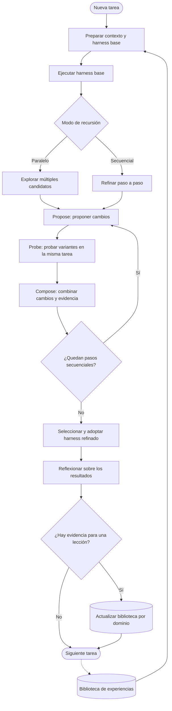

# 🚀 Harness² en la práctica: agentes de IA, recursión y experimentación con Google Colab

[](https://www.python.org/)
[](https://jupyter.org/)
[](https://colab.research.google.com/)
[](https://github.com/google-research/harness2)
[](./LICENSE)
[](https://github.com/google-research/harness2/blob/main/LICENSE)

> **¿Puede mejorar un agente de inteligencia artificial sin volver a entrenar el modelo?** Este proyecto explora esa pregunta mediante una demostración práctica de **Harness²**, el framework de Google Research que refina el sistema que rodea a un agente —sus instrucciones, herramientas, scripts y otros componentes— y conserva experiencia respaldada por evidencia para orientar tareas posteriores.

Este repositorio acompaña el tutorial en español con una explicación desde cero, un workflow visual, código ejecutable en Google Colab y un informe transparente de lo que se observó en la demo. 🧪📊

💙 **Code with heart — create with soul.**  
🌱 **Construimos. Aprendemos. Compartimos.**

**Aviso de alcance:** este material es un experimento educativo independiente basado en el repositorio público de Google Research. No es un producto oficial soportado por Google ni una reproducción completa de los experimentos académicos publicados. La demo local usa editores deterministas; no llama a un modelo de lenguaje remoto.

---

## Tabla de contenidos

- [Resumen del proyecto](#resumen-del-proyecto)
- [¿Qué es Harness²?](#qué-es-harness)
- [¿Por qué estudiar este enfoque?](#por-qué-estudiar-este-enfoque)
- [Conceptos clave](#conceptos-clave)
- [Workflow de Harness²](#workflow-de-harness)
- [Diseño de nuestro experimento](#diseño-de-nuestro-experimento)
- [Ejemplo práctico: conciliación de transacciones](#ejemplo-práctico-conciliación-de-transacciones)
- [Resultados observados en Colab](#resultados-observados-en-colab)
- [Qué resultados no obtuvimos](#qué-resultados-no-obtuvimos)
- [Cómo reproducir la demo](#cómo-reproducir-la-demo)
- [Cómo interpretar `demo.json`](#cómo-interpretar-demojson)
- [Limitaciones y amenazas a la validez](#limitaciones-y-amenazas-a-la-validez)
- [Siguientes experimentos](#siguientes-experimentos)
- [Estructura de los artefactos](#estructura-de-los-artefactos)
- [Desarrolladora](#desarrolladora)
- [Licencia](#licencia)
- [Referencias](#referencias)

---

## Resumen del proyecto

✨ **En una frase:** aprender a mejorar el sistema alrededor de un agente a partir de lo que ocurre al ejecutarlo.

Harness² aborda una idea importante en el desarrollo de agentes: **el rendimiento no depende únicamente del modelo base; también depende del sistema de ejecución que lo guía**.

Un modelo puede ser potente y, aun así, fallar si recibe instrucciones ambiguas, usa una herramienta incorrecta, aplica un script con errores o no aprovecha experiencias anteriores. Harness² explora cómo refinar ese sistema de forma recursiva, comparando ejecuciones y conservando aprendizajes justificados por evidencia.

Este tutorial tiene tres objetivos:

1. **Comprender** qué significa *harness* y cómo funciona el ciclo **Propose–Probe–Compose**.
2. **Ejecutar** la demo local oficial `harness2-demo` en un entorno de Google Colab, sin credenciales de modelos.
3. **Analizar** el informe JSON generado, distinguiendo entre una ejecución correcta de la demo y una evaluación formal del rendimiento de un agente.

### Estado de la prueba documentada

| Indicador de la demo local | Resultado observado |
|---|---:|
| Dominio de la demo | Contabilidad (`accounting`) |
| Tareas del ejemplo | 2 |
| Tareas completadas | 2 |
| Tareas fallidas | 0 |
| Ejecuciones registradas (`execution_count`) | 28 |
| Llamadas al editor determinista (`editor_calls`) | 32 |
| Presupuesto de recursión | `k = 2` |
| Modos solicitados | Paralelo y secuencial (`--mode both`) |
| Credenciales de un LLM | No requeridas para la demo local |
| Puntuación de benchmark con un LLM real | No obtenida en esta ejecución |

Estos números proceden del archivo `demo.json` guardado por el notebook compartido. **Describen la ejecución de la demostración local; no son una mejora porcentual de calidad ni prueban una ventaja estadística frente a un baseline.**

---

## ¿Qué es Harness²?

🧠 **Idea central:** el modelo es importante, pero el sistema que lo guía también.

El proyecto original se titula *Harness²: Recursive Agent Harnessing for an Open World*.

Un **harness** es el conjunto de componentes que permite que un modelo actúe como agente. Puede contener instrucciones del sistema, guardrails, memoria, guía de herramientas, subagentes, skills, scripts, plugins y lógica de orquestación.

Una analogía sencilla: el modelo es el motor; el harness es el equipo que permite que el motor trabaje en un entorno real. Cambiar el motor es una forma de mejorar el vehículo, pero también puede ayudar revisar los controles, la dirección o el procedimiento de uso.

Harness² conecta dos niveles de recursión y mantiene fijos los pesos del modelo durante el proceso de adaptación:

1. **Recursión a nivel de tarea:** propone modificaciones al harness para la tarea actual, ejecuta variantes y combina la evidencia observada para producir una versión refinada.
2. **Recursión a nivel de mejora del harness:** conserva el harness adoptado y lecciones respaldadas por evidencia para orientar el trabajo en tareas posteriores.

La intención es adaptarse a un entorno abierto, donde pueden aparecer tareas que no estaban disponibles cuando se diseñó inicialmente el agente.

> Harness² no es un nuevo modelo de lenguaje. Es un framework que optimiza componentes alrededor del agente. Tampoco implica que cada modificación vaya a funcionar: las propuestas se deben probar y sus resultados deben interpretarse con cuidado.

Fuente: [repositorio oficial de Harness²](https://github.com/google-research/harness2) y [artículo de investigación en arXiv](https://arxiv.org/abs/2610.14224).

## ¿Por qué estudiar este enfoque?

En una aplicación con agentes de IA, cambiar de modelo no siempre es la primera ni la única solución. A veces el problema está en cómo se define la tarea, en qué herramienta se invoca, en cómo se ejecuta un script o en la ausencia de un procedimiento validado.

Harness² es interesante porque convierte parte de esa mejora en un proceso sistemático:

- plantea cambios en lugar de asumir que la configuración inicial es óptima;
- ejecuta variantes sobre la misma tarea para poder comparar su comportamiento;
- combina los resultados observados para refinar el harness;
- registra experiencia que puede ser útil para tareas posteriores del mismo dominio.

Estudiarlo permite explorar ideas de ingeniería de agentes, experimentación reproducible, evaluación, memoria de sistemas y mejora de herramientas, sin confundirlas con el entrenamiento del propio modelo.

## Conceptos clave

🔁 Tres ideas ayudan a entender el enfoque: proponer, probar y componer; explorar en paralelo o refinar de forma secuencial; y conservar experiencia respaldada por evidencia.

### Propose–Probe–Compose

| Etapa | En español | Qué hace |
|---|---|---|
| **Propose** | Proponer | Sugiere cambios a uno o más componentes del harness. |
| **Probe** | Probar | Ejecuta las variantes en la tarea y recoge evidencia del comportamiento. |
| **Compose** | Componer | Utiliza los contrastes entre ejecuciones para construir un harness refinado. |

La idea central es comparar comportamientos observados. En el método general, el proceso no depende necesariamente de disponer de una respuesta de referencia para cada tarea nueva. Sin embargo, **la demo contable incluida aquí es determinista y utiliza el saldo de los datos para seleccionar el candidato correcto**; por tanto, sirve para entender el flujo del software, no para validar por sí sola todas las propiedades del método de investigación.

### Recursión paralela y secuencial

- **Paralela (`--mode parallel`):** explora múltiples candidatos y compone refinamientos a partir del conjunto de ejecuciones y de la evidencia disponible.
- **Secuencial (`--mode sequential`):** realiza pasos sucesivos y lleva el harness refinado y la evidencia acumulada al siguiente paso.
- **Presupuesto `k`:** controla cuánta recursión a nivel de tarea se utiliza. Un valor mayor implica más trabajo y, en ejecuciones con modelos remotos, puede aumentar el coste.

### Los componentes que pueden formar parte de un harness

Harness² expone ocho áreas editables:

| Componente | Ejemplo ilustrativo |
|---|---|
| System prompt | Instrucciones para revisar supuestos antes de responder. |
| Guardrails | Límites que impiden acciones no autorizadas. |
| Memoria | Experiencia previa relevante para el dominio. |
| Tool guidance | Indicaciones sobre cuándo y cómo utilizar una herramienta. |
| Subagents | Delegación de subtareas. |
| Skills | Procedimientos especializados reutilizables. |
| Scripts | Código que automatiza una operación concreta. |
| Plugins | Integraciones y middleware del entorno del agente. |

La disponibilidad y configuración específica dependen del *substrate* y del entorno de ejecución. Consulta la descripción oficial de [Harness components](https://github.com/google-research/harness2#harness-components).

## Workflow de Harness²

El siguiente diagrama resume el concepto de forma didáctica. No representa cada detalle interno del código, pero reúne los dos ciclos descritos por el proyecto: el refinamiento de la tarea y la conservación de experiencia.



## Diseño de nuestro experimento

🔬 Aquí documentamos una demostración educativa, no un benchmark formal de rendimiento.

### Pregunta de exploración

**¿Podemos ejecutar y observar en Colab el flujo de adaptación recursiva y la biblioteca de experiencia de Harness² sin configurar credenciales de un modelo remoto?**

Esta es una pregunta de ejecución y comprensión del framework, no una hipótesis sobre cuánto mejora el rendimiento de un LLM.

### Método

| Elemento | Configuración documentada |
|---|---|
| Entorno | Google Colab |
| Python de la virtualenv | Python 3.12.15, instalada con `uv` |
| Fuente | Clon superficial (`--depth 1`) de la rama `main` del repositorio oficial |
| Comando principal | `harness2-demo --output /content/harness2-demo --k 2 --mode both` |
| Dominio | `accounting` |
| Tareas | `ledger-1` y `ledger-2` |
| Modos | Paralelo y secuencial |
| Editor | `DemoProposer`, programado de forma determinista en Python |
| Modelo remoto | No se utiliza en la demo local |
| Archivo principal de resultados | `/content/harness2-demo/demo.json` |

**Reproducibilidad:** el notebook clona `main` sin fijar un hash de commit en el informe guardado. Para una reproducción exacta futura, conviene registrar `git rev-parse HEAD`, la fecha de ejecución y las versiones instaladas.

### Caso de uso: una conciliación contable

La demo representa dos libros contables pequeños. El error inicial consiste en sumar únicamente los importes positivos y excluir los negativos, que representan abonos en este ejemplo.

| Tarea | Importes | Total del script inicial | Total neto esperado |
|---|---|---:|---:|
| `ledger-1` | 100.25, -20.10, 5.00 | 105.25 | 85.15 |
| `ledger-2` | 35.50, -10.25, -5.00 | 35.50 | 20.25 |

La modificación de la demo elimina el filtro que descartaba importes negativos. El editor determinista selecciona la variante cuyo resultado coincide con el total calculado a partir de los datos de la tarea.

Este pequeño ejemplo permite comprender cómo una modificación de un script cambia la ejecución y cómo se puede registrar una lección. **No debe interpretarse como una prueba financiera ni utilizarse para conciliar datos reales.**

## Resultados observados en Colab

✅ **Resultado operativo de la demo:** 2 tareas completadas y 0 fallidas. Estos valores describen la ejecución guardada, no una mejora de calidad de un LLM.

La salida de la ejecución registrada en el notebook contiene el siguiente resumen de `demo.json`:

```json
{
  "domain": "accounting",
  "n_tasks": 2,
  "seed": null,
  "done": 2,
  "failed": 0,
  "tasks": [
    {
      "task": "ledger-1",
      "status": "ok",
      "library_entries_before": {"agg": 0, "seq": 0}
    },
    {
      "task": "ledger-2",
      "status": "ok",
      "library_entries_before": {"agg": 1, "seq": 1}
    }
  ],
  "execution_count": 28,
  "editor_calls": 32
}
```

### Lectura de los datos

1. **Las dos tareas terminaron:** `done = 2` y `failed = 0`.
2. **El flujo recorrió ambos modos:** el comando se ejecutó con `--mode both` y `k = 2`.
3. **Hubo actividad interna:** el informe registra 28 ejecuciones y 32 llamadas al editor determinista. Estas cifras son contadores operativos de la demo, no puntuaciones de calidad.
4. **La biblioteca registra experiencia entre tareas:** en `ledger-1`, la biblioteca aparece vacía antes del procesamiento (`agg = 0`, `seq = 0`); antes de `ledger-2` figura una entrada en cada modo (`agg = 1`, `seq = 1`). Esto es consistente con que la demo persiste una experiencia entre tareas de este mismo dominio.
5. **El resultado depende de una demo controlada:** la implementación utiliza un proponente y un selector escritos expresamente para este caso contable. No se debe generalizar desde dos tareas sintéticas.

### ¿Qué podemos concluir?

La evidencia permite afirmar que, en la ejecución guardada, la demo local **completó sus dos tareas sin fallos reportados y produjo el informe esperado**. También permite inspeccionar los contadores de ejecución y la presencia de entradas de experiencia entre las dos tareas.

No permite afirmar que Harness² aumentó la precisión de Gemini, Claude u otro modelo, ni que el modo paralelo superó al secuencial. La ejecución no calculó una puntuación de benchmark, no realizó una comparación estadística y no utilizó un LLM remoto.

## Qué resultados no obtuvimos

⚠️ La transparencia importa: no reportamos puntuaciones de benchmark que no se hayan obtenido.

El notebook también contiene un intento de preparar el benchmark **LAB**. Ese intento no llegó a una evaluación válida. La salida guardada reporta, entre otros problemas:

- falta la variable de configuración `HARNESS2_SOLVER_MODEL`;
- falta `pdftoppm`, una herramienta incluida en Poppler que LAB necesita;
- el comando de evaluación falla por la ausencia de configuración del modelo y no encuentra resultados juzgados que reportar.

Por tanto, en este proyecto **no hay una puntuación obtenida por nosotros en LAB, JobBench o WorkBuddy-Bench**. Los resultados publicados por los autores se resumen en una sección separada para no mezclarlos con lo que se observó en Colab.

### Resultados reportados por los autores de Harness²

El README y el artículo de investigación oficiales reportan que, en tres benchmarks profesionales y cuatro configuraciones de modelo–harness, un paso de Harness² mejoró los resultados de GLM-5 y Gemini 3.5 Flash respecto a sus harnesses base. Los máximos informados incluyen:

| Benchmark | Mejora máxima reportada por los autores |
|---|---:|
| WorkBuddy-Bench | Hasta 11.5 puntos |
| JobBench | Hasta 4.5 puntos |
| LAB, tasa de aprobación parcial | Hasta 11.8 puntos porcentuales |

Estas cifras pertenecen a los experimentos del proyecto original; **no son resultados de nuestro notebook**. Deben leerse con las configuraciones, métricas y límites definidos en el paper y la documentación oficial.

Fuentes: [README oficial](https://github.com/google-research/harness2) · [Paper en arXiv](https://arxiv.org/abs/2610.14224) · [Guía oficial de experimentos](https://github.com/google-research/harness2/blob/main/docs/EXPERIMENTS.md).

## Cómo reproducir la demo

💻 Sigue estos pasos en una sesión de Colab limpia y ejecuta las celdas en orden.

La ruta más sencilla es abrir el notebook `harness2_tutorial.ipynb` en Google Colab y ejecutar las celdas introductorias en orden. El cuaderno instala una virtualenv con Python 3.12 y corre la demo local oficial.

### Instalación desde una sesión limpia

Los siguientes comandos resumen la ruta de instalación utilizada en el notebook. Deben ejecutarse en celdas de Colab:

```bash
# Clonar el repositorio oficial
%cd /content
!git clone --depth 1 https://github.com/google-research/harness2.git
%cd /content/harness2

# Instalar uv y crear un entorno con Python 3.12
!curl -LsSf https://astral.sh/uv/install.sh | sh
!uv python install 3.12
!uv venv --python 3.12 .venv
!uv pip install --python .venv/bin/python -e '.[render]'
```

Ejecuta la demo con ambos modos y `k = 2`:

```bash
!./.venv/bin/harness2-demo --output /content/harness2-demo --k 2 --mode both
```

Salida observada en la ejecución compartida:

```text
[accounting] 1/2 ok  ledger-1
[accounting] 2/2 ok  ledger-2
Local demo: 2 tasks completed; 0 failed.
```

Para examinar el resumen:

```python
import json
from pathlib import Path

report_path = Path('/content/harness2-demo/demo.json')
report = json.loads(report_path.read_text(encoding='utf-8'))
print(json.dumps(report, indent=2, ensure_ascii=False))
```

> **Importante:** no es necesario activar `RUN_REAL_BENCHMARK` ni ejecutar las celdas de benchmark para reproducir este resultado de demo. Los benchmarks reales necesitan instalación, configuración de proveedor/modelo, autenticación, dependencias específicas y una revisión previa de sus costes y restricciones de red.

### Enlace del notebook

- [`harness2_tutorial.ipynb`](./harness2_tutorial.ipynb) — tutorial en español, ejemplo de transacciones, ejecución de la demo, análisis de `demo.json` y workflow.

Si el notebook está publicado en GitHub, puedes abrirlo desde el repositorio y elegir **Open in Colab**, o subir el `.ipynb` directamente a [Google Colab](https://colab.research.google.com/).

## Cómo interpretar `demo.json`

| Campo | Significado |
|---|---|
| `domain` | Dominio de trabajo usado por la demo. |
| `n_tasks` | Número de tareas del conjunto local. |
| `done` | Tareas completadas correctamente. |
| `failed` | Tareas que la demo registra como fallidas. |
| `tasks` | Estado por tarea y contadores de experiencia antes de su procesamiento. |
| `execution_count` | Número de ejecuciones registradas por el adaptador local. |
| `editor_calls` | Número de llamadas registradas al proponente/editor durante el flujo. |

Un contador de ejecución no equivale a precisión, calidad o coste. Para evaluar calidad de forma cuantitativa se necesita un benchmark con criterios explícitos, una línea base comparable y un protocolo de evaluación controlado.

## Limitaciones y amenazas a la validez

🧭 Estas limitaciones ayudan a delimitar las conclusiones y a diseñar el siguiente experimento con más rigor.

Esta prueba es principalmente educativa y de verificación funcional.

- **Conjunto pequeño:** solo dos tareas sintéticas de contabilidad.
- **Editor determinista:** la demo no solicita propuestas a un LLM remoto.
- **Selección específica del ejemplo:** el selector conoce el total esperado calculándolo desde los datos de entrada.
- **Sin métrica de calidad del agente:** `done = 2` representa finalización de las tareas de demo, no una tasa de éxito independiente en un benchmark.
- **Sin comparación estadística:** no existe una evaluación que demuestre superioridad de un modo sobre otro.
- **Fuente no fijada por commit:** el notebook clona `main` y no guarda el hash exacto de la revisión utilizada.
- **Benchmark LAB no completado:** los errores de configuración y dependencias impidieron obtener resultados de evaluación.
- **Costes y seguridad:** los benchmarks basados en modelos pueden generar costes. Además, la documentación oficial advierte de que el acceso a la web puede exponer al agente a rúbricas o criterios públicos de evaluación.

Estas limitaciones no invalidan el uso del notebook como tutorial, pero sí delimitan las conclusiones que se pueden extraer de sus resultados.

## Siguientes experimentos

🚀 Para llevar la demo a una comparación experimental más sólida, proponemos la siguiente ruta.

Para pasar de una demostración funcional a una investigación comparativa, una ruta razonable sería:

1. **Fijar el entorno:** guardar el hash del commit, versiones de Python y dependencias y parámetros exactos de ejecución.
2. **Completar la configuración de LAB:** instalar las dependencias requeridas, configurar un modelo compatible y verificar el entorno con `harness2-check`.
3. **Definir una baseline:** evaluar el harness base con la misma selección de tareas y el mismo evaluador que el harness refinado.
4. **Comparar modos con condiciones constantes:** mantener iguales tarea, modelos, presupuesto `k`, semilla y demás parámetros.
5. **Registrar métricas relevantes:** resultados por tarea, tareas sin puntuar, costes, tiempo, artefactos y errores de ejecución.
6. **Controlar el acceso a la red:** seguir las recomendaciones oficiales para reducir la posibilidad de que el agente consulte información de evaluación.
7. **Separar los resultados de investigación de los didácticos:** nunca presentar los dos libros contables como prueba de rendimiento general.

Guías del proyecto original: [SETUP](https://github.com/google-research/harness2/blob/main/docs/SETUP.md), [BENCHMARKS](https://github.com/google-research/harness2/blob/main/docs/BENCHMARKS.md) y [EXPERIMENTS](https://github.com/google-research/harness2/blob/main/docs/EXPERIMENTS.md).

## Estructura de los artefactos

Al completar la demo, el directorio de salida contiene el resumen y los artefactos de las tareas. La organización exacta puede cambiar entre versiones del repositorio, pero el informe central de esta prueba se encuentra en:

```text
/content/harness2-demo/
├── demo.json                 # Resumen de la demo
├── base/                     # Harness inicial
├── executions/               # Resultados y trayectorias de ejecución
└── library/                  # Experiencia persistente organizada por configuración
```

Los artefactos se generan en el entorno de Colab. Para conservarlos fuera de la sesión, descárgalos o guárdalos en una ubicación persistente autorizada.

## Desarrolladora

### 👩🏻‍💻 Orli

**Systems Engineer · Full Stack Developer · AI & Data Explorer · Community Builder**

Creo en aprender haciendo, compartir lo aprendido y hacer preguntas incómodas cuando vale la pena. Este laboratorio nace con una intención muy simple:

> 💡 **Entender antes de opinar. Experimentar antes de asumir.**

💙 **Code with heart — create with soul.**

🌱 **Construimos. Aprendemos. Compartimos.**

Este proyecto reúne divulgación tecnológica, experimentación práctica y aprendizaje abierto. La idea es que cualquier persona interesada pueda explorar el flujo, revisar las limitaciones y continuar experimentando desde su propio entorno.

## Licencia

📄 **Los materiales originales de este laboratorio educativo se publican bajo la [MIT License](./LICENSE).** Puedes usarlos, copiarlos, modificarlos, distribuirlos y aprovecharlos incluso en proyectos comerciales, siempre que conserves el aviso de copyright y el texto de licencia correspondiente.

El aviso de copyright de estos materiales es **Copyright (c) 2026 Orli**.

⚖️ **Importante:** la licencia MIT de los materiales originales de este repositorio no cambia la licencia de Harness² ni la de las dependencias, benchmarks, datasets o materiales de terceros. El repositorio upstream de Harness² indica **Apache License 2.0** para su proyecto; los componentes externos conservan sus respectivas licencias y condiciones. Revisa siempre las licencias de origen antes de redistribuir código o datos.

## Referencias

1. 🧰 **Repositorio oficial de Harness²** — código, componentes, instalación, demo y resultados reportados: https://github.com/google-research/harness2
2. 📚 **Artículo de investigación** — *Harness²: Recursive Agent Harnessing for an Open World*: https://arxiv.org/abs/2610.14224
3. ⚙️ **Guía de instalación** — dependencias y autenticación: https://github.com/google-research/harness2/blob/main/docs/SETUP.md
4. 📊 **Guía de benchmarks** — JobBench, LAB y WorkBuddy-Bench: https://github.com/google-research/harness2/blob/main/docs/BENCHMARKS.md
5. 🔬 **Guía de experimentos** — modos, presupuestos, selección de tareas, baseline y acceso web: https://github.com/google-research/harness2/blob/main/docs/EXPERIMENTS.md
6. 💻 **Tutorial de Google Colab incluido en este proyecto** — [`harness2_tutorial.ipynb`](./harness2_tutorial.ipynb)

---

### 💚 Idea final

Harness² nos invita a mirar más allá del modelo: observar el harness, proponer un cambio, probarlo, combinar la evidencia y conservar lo que realmente aprendimos. La demo local permite ver esa mecánica en pequeño. El siguiente paso —y el que requiere más rigor— es comprobar si esa adaptación mejora tareas reales bajo condiciones controladas.
